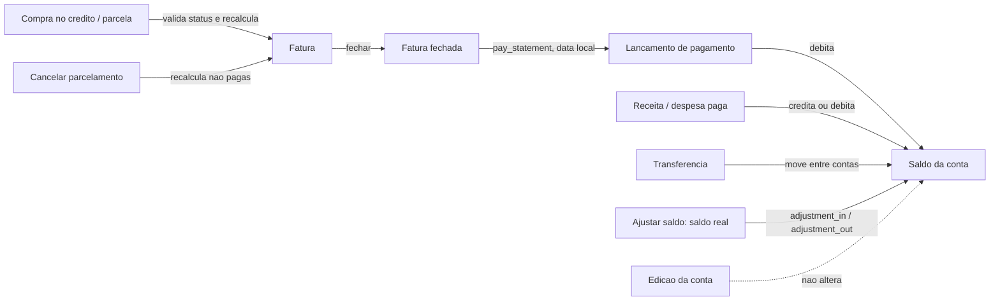

# Spec 013 - Integridade de Saldo e Fatura

Herda a baseline da spec 000. Entrega 1.2 da Etapa 1 do plano-mestre (Confluence, espaco FIN, pagina 950274). Segue a ADR-012 (padroes de arquitetura), implementa a ADR-009 (ajuste de saldo como acao da conta) e respeita a ADR-005 (definicao de gasto).

Issues: #221 (FIN-7), #224, #226, #227, #231.

## Contexto

O code review de 23/10/2026 achou caminhos em que saldo de conta e valor de fatura deixam de bater com os lancamentos:

- compras no credito e parcelas entram em fatura paga e nao recalculam a fatura (#221);
- a edicao generica de lancamento altera pagamento de fatura e previsao sem mexer na fatura, e aceita "Transferencia" sem criar `Transfer` (#224);
- o tipo "Ajuste" e gravado sem efeito no saldo nem em totais (#226);
- editar a conta sobrescreve o saldo sem lock, e `/accounts/` soma contas inativas que os relatorios ignoram (#231);
- datas de negocio usam o fuso do sistema operacional, nao o do projeto (#227).

Com dados reais entrando na Etapa 1, cada divergencia vira saldo errado sem rastro.

## Objetivo

- Saldo de conta muda somente por lancamento, transferencia, pagamento de fatura ou ajuste explicito, sempre com registro.
- Os valores gravados da fatura (`expected_amount`, `closed_amount`) acompanham as compras ativas vinculadas em todo fluxo que cria, edita ou cancela compra.
- `/accounts/` e relatorios usam o mesmo criterio de patrimonio.
- Datas de negocio seguem `America/Sao_Paulo`.

## Fora de Escopo

| Item | Motivo |
| ---- | ------ |
| Correcao retroativa de faturas e saldos ja divergentes | Alterar saldo ou fatura retroativamente e Ask First na spec 000; o ajuste de saldo (ADR-009) e o caminho manual. |
| Estorno ou edicao de pagamento de fatura | Fluxo proprio ainda nao existe; aqui so se bloqueia a edicao generica. |
| Importacao de extratos | Spec 014 (entrega 1.3). |
| Formulario de lancamento (layout e campos) | Spec 015 (entrega 1.4); aqui so muda a lista de tipos permitidos. |
| Rotina diaria de fechamento e atraso de faturas | ADR-013, Etapa 2. |
| Alerta de fatura da home (#219) | Conferir depois da #221, como previsto no plano-mestre (Etapa 2.4). |
| Subtotal de contas inativas nos relatorios | Decisao: total so de ativas; inativas ficam listadas a parte apenas em `/accounts/`. |

## Schema

Muda schema apenas na #226:

- `transactions/migrations/0007_adjustment_in_out.py` substitui a choice `adjustment` por `adjustment_in` ("Ajuste de entrada") e `adjustment_out` ("Ajuste de saida") em `Transaction.transaction_type`. Altera so as choices; nenhum dado e convertido.
- Antes de alterar, a migration conta lancamentos com `transaction_type="adjustment"`. Se houver algum, falha com `RuntimeError` listando os ids e nao altera nada.
- Impacto em dados gravados: nenhum (banco de dev sem ajustes; producao bloqueia a migration se houver).
- Verify: `python manage.py makemigrations --check --dry-run` sem migrations adicionais depois da 0007.

As demais issues nao mudam schema.

## Suposicoes e Questoes Abertas

| Suposicao / decisao | Padrao escolhido | Motivo | Confirmado? |
| ------------------- | ---------------- | ------ | ----------- |
| Spec 013 nao existia quando a #221 foi entregue | A #221 foi entregue pela issue + spec 000 + ADR-012 (PR #253) e entra aqui como verificada | Decisao do usuario na task review da #221 | s |
| Bloqueio da edicao generica (#224) | GET e POST de edicao redirecionam ao detalhe com `messages.warning` explicando o fluxo proprio; o botao Editar some do detalhe | Decisao do usuario; segue messages/redirect da spec 000 | s |
| Tipos fora da edicao generica | `statement_payment`, `forecast`, `adjustment_in`, `adjustment_out` | Cada um tem fluxo proprio (fatura, recorrencia, ajuste na conta) | s |
| Contas inativas (#231) | Total por moeda de `/accounts/` soma so contas ativas, igual a `get_account_net_worth`; inativas seguem listadas, marcadas, fora do total | Decisao do usuario; uma regra so | s |
| Lancamentos `adjustment` legados | Migration aborta com `RuntimeError` listando os ids | Decisao do usuario; o sinal nao pode ser inferido | s |
| Ajuste em conta inativa | Recusado com `ValidationError("Reative a conta para ajustar o saldo.")` | Decisao do usuario; coerente com total so de ativas | s |
| Data do ajuste | `timezone.localdate()` no momento da acao, sem campo de data | Ajuste corrige o saldo atual; data retroativa nao muda nada fora da lista | n |
| Descricao do ajuste | "Ajuste de saldo" mais observacao opcional digitada pelo usuario | Rastro legivel na lista e no detalhe da conta | n |
| Saldo real negativo | Aceito | Conta corrente pode ficar negativa; o model nao restringe | n |
| Correcao de ajuste errado | Novo ajuste; ajuste nao e editavel nem cancelavel | Mantem historico; ADR-009 grava sempre como pago | n |
| Checagem de `date.today()` / `datetime.now()` (ADR-012) | Teste em `core/tests/` que varre os `.py` do projeto (exceto `tests/`, `migrations/`, `venv/`, `.claude/`) | ADR-012 pede checagem automatica; mudar CI e Ask First | n |
| Ordem de entrega | #227, #226, #224, #231 | #231 depende do ajuste (#226); #224 inclui os tipos de ajuste | n |

**Open questions:** none - todas resolvidas ou registradas acima.

## Historias

### P1: Fatura consistente ao lancar e cancelar compras (#221) - entregue no PR #253

**Historia:** Como usuario, quero que a fatura reflita as compras validas para pagar o valor certo.

**Criterios de Aceite:**

1. SE a fatura resolvida para uma compra no credito (a vista ou parcela) esta paga ou cancelada ENTAO o sistema DEVE recusar a compra com `ValidationError` e nao gravar compra, plano nem parcela.
2. QUANDO uma compra no credito e criada ENTAO o sistema DEVE recalcular `expected_amount` da fatura vinculada, e `closed_amount` quando a fatura esta fechada e nao paga.
3. QUANDO um parcelamento gera parcelas ENTAO o sistema DEVE recalcular cada fatura afetada uma unica vez.
4. QUANDO um parcelamento e cancelado ENTAO o sistema DEVE recalcular as faturas das parcelas canceladas que nao estao pagas nem canceladas.

**Teste independente:** compra em fatura paga e recusada; cancelar parcelamento com fatura fechada reduz `closed_amount`.

### P1: Datas no fuso do projeto (#227)

**Historia:** Como usuario, quero que pagamento e atraso usem o meu dia, nao o do servidor.

**Criterios de Aceite:**

1. QUANDO uma fatura e paga ENTAO o sistema DEVE gravar o lancamento de pagamento com `date = timezone.localdate()`.
2. QUANDO `update_statement_status` roda sem `today` ENTAO o sistema DEVE comparar o vencimento com `timezone.localdate()`.
3. QUANDO a meta mensal e criada pela tela de categoria ENTAO o sistema DEVE usar `timezone.localdate()` como data de referencia.
4. QUANDO `backup_db` roda sem `now` ENTAO o sistema DEVE nomear a copia com `timezone.localtime()`.
5. O sistema DEVE manter zero ocorrencias de `date.today()` e `datetime.now()` em codigo de producao, verificadas por teste automatizado.

**Teste independente:** com `timezone.localdate` mockado em 31/10, pagar fatura grava 31/10 mesmo com UTC em 01/11.

### P1: Ajuste de saldo pela conta (#226, ADR-009)

**Historia:** Como usuario, quero informar o saldo real de uma conta para corrigir divergencias, deixando registro.

**Criterios de Aceite:**

1. QUANDO o usuario informa um saldo real maior que o saldo atual de uma conta ativa ENTAO o sistema DEVE gravar um lancamento `adjustment_in`, pago, com a diferenca absoluta, e somar a diferenca ao saldo.
2. QUANDO o usuario informa um saldo real menor que o saldo atual de uma conta ativa ENTAO o sistema DEVE gravar um lancamento `adjustment_out`, pago, com a diferenca absoluta, e subtrair a diferenca do saldo.
3. QUANDO o saldo real informado e igual ao saldo atual ENTAO o sistema DEVE nao gravar lancamento nem alterar o saldo, e avisar que nada mudou.
4. O sistema DEVE calcular a diferenca a partir da conta relida com `select_for_update` dentro de `transaction.atomic`.
5. SE a conta esta inativa ENTAO o sistema DEVE recusar o ajuste com `ValidationError("Reative a conta para ajustar o saldo.")`.
6. O sistema DEVE manter `adjustment_in` e `adjustment_out` fora de receita, gasto, metas e insights.
7. O sistema DEVE exibir os ajustes na lista de lancamentos e no detalhe da conta.
8. O sistema DEVE excluir "Ajuste" das opcoes de tipo do formulario de lancamento, na criacao e na edicao.
9. SE um POST do formulario de lancamento traz um tipo de ajuste ENTAO o sistema DEVE recusar com erro no campo `transaction_type`.
10. SE existem lancamentos `adjustment` ao aplicar a migration 0007 ENTAO o sistema DEVE abortar com `RuntimeError` listando os ids, sem alterar dados.

**Teste independente:** conta com R$ 1.000,00, saldo real R$ 950,00 gera `adjustment_out` de R$ 50,00 e saldo R$ 950,00; repetir o mesmo POST nao gera novo lancamento.

### P1: Edicao generica restrita (#224)

**Historia:** Como usuario, quero que a edicao de lancamento nao quebre fatura nem simule transferencia.

**Criterios de Aceite:**

1. QUANDO o usuario abre (GET) ou envia (POST) a edicao de um lancamento `statement_payment`, `forecast`, `adjustment_in` ou `adjustment_out` ENTAO o sistema DEVE redirecionar ao detalhe do lancamento com `messages.warning` indicando o fluxo proprio, sem alterar o lancamento.
2. O sistema DEVE omitir o botao Editar no detalhe desses lancamentos.
3. SE o POST de edicao traz `payment_method=transfer` ENTAO o sistema DEVE devolver o form com erro "Transferência não pode ser editada por aqui; crie uma transferência." e nao alterar o lancamento.
4. QUANDO o usuario edita receita, despesa, compra no cartao ou compra no beneficio ENTAO o sistema DEVE manter o comportamento atual de `update_transaction`.

**Teste independente:** editar o "Pagamento fatura ..." de uma fatura parcialmente paga redireciona com aviso e mantem `paid_amount` e saldo.

### P1: Saldo protegido e patrimonio unico (#231)

**Historia:** Como usuario, quero que editar a conta nao apague movimentacoes e que o total de contas bata com os relatorios.

**Criterios de Aceite:**

1. QUANDO uma conta e criada ENTAO o sistema DEVE gravar o saldo informado como saldo inicial.
2. QUANDO uma conta existente e editada ENTAO o sistema DEVE manter o saldo gravado, ignorando qualquer `balance` enviado no POST.
3. O sistema DEVE exibir o saldo como somente leitura na edicao, com link para "Ajustar saldo".
4. O sistema DEVE somar no total por moeda de `/accounts/` somente contas ativas.
5. O sistema DEVE listar as contas inativas em `/accounts/` marcadas como inativas, com saldo visivel e fora do total.

**Teste independente:** editar so o nome de uma conta cujo saldo mudou em outra aba preserva o saldo novo; conta inativa com saldo nao entra no total de `/accounts/` nem no patrimonio.

## Casos de Borda

- SE duas abas enviam o mesmo ajuste ENTAO o sistema DEVE aplicar a diferenca uma vez, porque a segunda le o saldo ja ajustado e encontra diferenca zero.
- SE o saldo real informado tem mais de duas casas decimais ENTAO o sistema DEVE recusar com erro de formulario.
- QUANDO o ajuste leva o saldo a valor negativo ENTAO o sistema DEVE aceitar e gravar o ajuste.
- SE o lancamento a editar nao existe ENTAO o sistema DEVE responder 404, como hoje.

## Regras Transversais

- Toda regra de saldo e fatura fica em service, roda em `transaction.atomic` com `select_for_update` e vale para criar, editar e cancelar (ADR-012).
- `full_clean()` antes de todo `save()`; `update()` em massa so com comentario.
- Erros de service chegam a tela por `core/errors.py` quando o modulo existir; ate la, pelo helper que a view ja usa.
- Nenhum GET grava no banco.

## Diagrama de Referencia

## Testes Esperados

- Service: ajuste de entrada, de saida, diferenca zero, conta inativa, repeticao idempotente (`accounts` ou `transactions`, onde o service morar).
- Migration: teste do guard que aborta com `adjustment` legado.
- Form e view: tipos de ajuste fora das opcoes; POST com ajuste recusado; edicao bloqueada para os quatro tipos com redirect e `messages`; `payment_method=transfer` na edicao recusado.
- View: edicao de conta ignora `balance`; criacao grava saldo inicial; tela de ajuste com sucesso, erro e redirect.
- Selector: `get_account_summary` soma so ativas e expoe as inativas a parte.
- Service: `pay_statement` e `update_statement_status` com `timezone.localdate` mockado.
- Teste de varredura sem `date.today()` / `datetime.now()` em producao.
- `python manage.py check`, `python manage.py makemigrations --check --dry-run`, `python manage.py test`.

## Ordem de Entrega

1. #221 - fatura consistente. Entregue (PR #253).
2. #227 - datas no fuso. Independente, sem schema.
3. #226 - ajuste de saldo (ADR-009). Unica com migration.
4. #224 - edicao restrita. Depende da #226 para bloquear os tipos de ajuste.
5. #231 - saldo protegido e patrimonio. Depende da #226 para o link "Ajustar saldo".

## Rastreabilidade

| Requirement ID | Historia | Issue | Status |
| -------------- | -------- | ----- | ------ |
| FAT-01 | P1: Fatura consistente - AC 1 | #221 | Verified |
| FAT-02 | P1: Fatura consistente - AC 2 | #221 | Verified |
| FAT-03 | P1: Fatura consistente - AC 3 | #221 | Verified |
| FAT-04 | P1: Fatura consistente - AC 4 | #221 | Verified |
| DAT-01 | P1: Datas no fuso - AC 1-2 | #227 | Verified |
| DAT-02 | P1: Datas no fuso - AC 3-4 | #227 | Verified |
| DAT-03 | P1: Datas no fuso - AC 5 | #227 | Verified |
| AJU-01 | P1: Ajuste de saldo - AC 1-4 | #226 | Verified |
| AJU-02 | P1: Ajuste de saldo - AC 5 | #226 | Verified |
| AJU-03 | P1: Ajuste de saldo - AC 6-7 | #226 | Verified |
| AJU-04 | P1: Ajuste de saldo - AC 8-9 | #226 | Verified |
| AJU-05 | P1: Ajuste de saldo - AC 10 | #226 | Verified |
| EDT-01 | P1: Edicao restrita - AC 1-2 | #224 | Pending |
| EDT-02 | P1: Edicao restrita - AC 3 | #224 | Pending |
| EDT-03 | P1: Edicao restrita - AC 4 | #224 | Pending |
| SAL-01 | P1: Saldo protegido - AC 1-3 | #231 | Pending |
| SAL-02 | P1: Saldo protegido - AC 4-5 | #231 | Pending |

**Cobertura:** 17 requisitos; 12 verificados (#221, #227, #226), 5 pendentes, todos ligados a uma issue.

## Criterios de Sucesso

- [ ] Nenhum fluxo que cria, edita ou cancela compra deixa `expected_amount`/`closed_amount` diferente da soma das compras ativas da fatura.
- [ ] Toda mudanca de saldo de conta tem um registro (lancamento, transferencia, pagamento ou ajuste).
- [ ] `/accounts/` e relatorios mostram o mesmo patrimonio por moeda.
- [ ] `check`, `makemigrations --check --dry-run` e `test` passam ao fim de cada issue.
