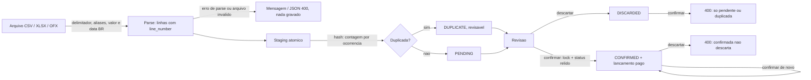

# Spec 014 - Importacao Confiavel

Herda a baseline da spec 000 e as regras de importacao da spec 006. Entrega 1.3 da Etapa 1 do plano-mestre (Confluence, espaco FIN, pagina 950274). Segue a ADR-012 (padroes de arquitetura) e a ADR-008 (SQLite com `transaction_mode=IMMEDIATE` em producao).

Issues: #234 (FIN-24), #235, #222, #223.

## Contexto

O code review de 23/10/2026 achou quatro problemas na importacao de extratos:

- o CSV trunca ou rejeita valores e datas no formato BR, nao aceita `;` como delimitador e so reconhece cabecalhos em ingles (#234);
- arquivos invalidos e valores com casas longas vindos do Excel geram erro 500 (#235);
- a confirmacao individual nao trava a linha: duplo clique cria dois lancamentos pagos e debita o saldo duas vezes, e linhas descartadas podem ser confirmadas (#222);
- linhas iguais no mesmo arquivo viram duplicadas, e "99" em qualquer posicao sugere Transporte (#223).

A Etapa 1 termina quando um mes real de extrato concilia com o banco. Com esses defeitos, o extrato real nao importa ou importa com valor errado sem aviso.

## Objetivo

- Extratos CSV e XLSX de bancos brasileiros importam sem edicao manual: cabecalho em portugues, `;` ou `,`, valor `-1.234,56`, data `dd/mm/aaaa`.
- Nenhum valor entra truncado ou arredondado sem aviso; arquivo invalido gera mensagem, nunca erro 500.
- Cada linha importada gera no maximo um lancamento.
- Linhas legitimas repetidas no mesmo arquivo continuam revisaveis.
- Um mes real de extrato concilia com o banco (teste de aceite abaixo).

## Fora de Escopo

| Item | Motivo |
| ---- | ------ |
| Importar fatura de cartao (compras como `card_purchase`) | Decisao do usuario: tratado no futuro, candidato da Etapa 4. Na 1.3 a fatura e conferida com lancamentos manuais. |
| Tela de mapeamento de colunas | Funcionalidade nova; a 1.3 cobre os cabecalhos comuns por aliases. |
| Colunas separadas de debito e credito, valor com `R$` ou sinal no fim (`10,50-`) | Formatos fora do padrao "uma coluna de valor com sinal"; revisitar se o extrato do aceite usar algum deles. |
| Reconhecer pagamento de fatura e transferencia entre contas proprias no extrato | Sem regra hoje; no aceite o usuario descarta essas linhas e usa o fluxo proprio. |
| Falso positivo de "mercado" (Mercado Livre, Mercado Pago) na categoria sugerida | Nao citado na #223 e a sugestao e revisavel; se aparecer no aceite, vira issue nova. |
| Mudancas no importador OFX | O OFX ja tem formato fixo e nao tem defeito aberto; so herda a recusa de `NaN`/`Infinity`. |
| Duplicidade entre origens diferentes (mesmo extrato em CSV e OFX) | O hash inclui a origem; fica para a deteccao contra lancamentos ja cadastrados. |
| Processamento assincrono de arquivos grandes | Fora de escopo desde a spec 006. |

## Schema

Nenhuma mudanca de schema. `ImportedTransaction` ja tem `import_hash` indexado, `external_id` e os status usados aqui.

- Verify: `python manage.py makemigrations --check --dry-run` sem migrations novas ao fim de cada issue.

## Suposicoes e Questoes Abertas

| Suposicao / decisao | Padrao escolhido | Motivo | Confirmado? |
| ------------------- | ---------------- | ------ | ----------- |
| Cabecalhos em portugues | Aliases fixos em CSV e XLSX, comparados sem caixa e sem acento: `date`/`data`; `description`/`descricao`/`historico`; `amount`/`valor`; `external_id`/`identificador` | Decisao do usuario; o extrato real importa sem edicao | s |
| Fatura no teste de aceite | Conferida com compras lancadas a mao no cartao; a linha de pagamento de fatura do extrato da conta e descartada e paga pelo fluxo da fatura | Decisao do usuario; a importacao so gera receita e despesa | s |
| Deteccao do delimitador | `;` quando a primeira linha nao vazia contem `;`; senao `,`. Sem campo novo no upload | Determinista e testavel; `csv.Sniffer` erra com poucas linhas. A #234 aceita "detectado ou escolhido" | n |
| Valor sem virgula com ponto | Ponto e separador decimal (`1234.56`). `1.234` tem tres casas e e recusado | Ambiguo entre milhar e decimal; recusar evita valor errado silencioso | n |
| Arredondamento | So celulas numericas do XLSX sao arredondadas (2 casas, `ROUND_HALF_UP`). Valor textual com mais de duas casas e recusado | A #235 mira o ruido de ponto flutuante do Excel; arredondar texto mudaria `1.234` para `1,23` | n |
| Datas aceitas | ISO e `dd/mm/aaaa` no CSV; no XLSX tambem o numero serial do Excel. `dd/mm/aa` e recusado | Reusa `DATE_INPUT_FORMATS` de `core/forms.py` | n |
| Importacoes anteriores na contagem de duplicidade | Todas contam, qualquer status (inclusive descartadas) | Mantem a regra atual; `DUPLICATE` continua revisavel e pode ser confirmada | n |
| Duplicidade contra lancamentos cadastrados | Mesma contagem por ocorrencia usada contra importacoes anteriores | Duas compras iguais no extrato e uma ja lancada a mao: so uma deve virar duplicada | n |
| Confirmar linha `DUPLICATE` | Permitido | Spec 006: duplicidade e alerta de revisao; `REVIEWABLE_IMPORT_STATUSES` ja inclui `DUPLICATE` | s |
| Confirmar linha ja confirmada | Devolve o lancamento existente: JSON 200 com o mesmo payload; na tela, `messages.info("Importação já confirmada.")` | Idempotencia pedida na #222; repetir nao e erro | n |
| Descarte individual de linha confirmada | Recusado com 400 / `messages.error`, como na confirmacao | Hoje o descarte individual aceita qualquer status e solta o lancamento da importacao; mesmo defeito de transicao da #222, nos mesmos arquivos | n |
| Lock em SQLite | `select_for_update` dentro de `transaction.atomic`; em producao o `IMMEDIATE` da ADR-008 serializa as escritas | `select_for_update` nao faz nada no SQLite; o `IMMEDIATE` garante a releitura | n |
| Erro de validacao no staging | Mensagem com o numero da linha de origem; a linha normalizada passa a carregar `line_number` | O usuario precisa saber qual linha corrigir | n |
| `csv.Error` (por exemplo, byte NUL) | Recusado com "Arquivo CSV inválido." | Mesmo defeito da #235 (excecao fora de `ValueError` vira 500) | n |
| Mensagens de erro | Pelo helper que a view ja usa; `core/errors.py` ainda nao existe | Igual a spec 013 | s |
| Extrato real | Nunca entra no repositorio; os testes usam fixtures sinteticas com o mesmo cabecalho, delimitador e formatos | Dado pessoal | n |
| Registro do aceite | Resumo sem valores nem descricoes (data, banco, formato, numero de linhas, diferenca por conta e fatura) no PR que fecha a 1.3 e no plano-mestre | Rastro sem expor dados pessoais | n |
| Ordem de entrega | #234, #235, #222, #223 | #235 reusa o parse de valor da #234; #222 e o risco maior de saldo; #223 por ultimo | n |

**Questoes abertas:** nenhuma - todas resolvidas ou registradas acima.

## Historias

### P1: Extrato no formato BR (#234)

**Historia:** Como usuario, quero importar o extrato do meu banco do jeito que ele exporta, sem editar o arquivo.

**Criterios de Aceite:**

1. QUANDO a primeira linha nao vazia do CSV contem `;` ENTAO o sistema DEVE usar `;` como delimitador.
2. QUANDO a primeira linha nao vazia do CSV nao contem `;` ENTAO o sistema DEVE usar `,` como delimitador.
3. QUANDO o cabecalho do CSV ou do XLSX usa um alias de coluna (`data`, `Descrição`, `HISTÓRICO`, `valor`, `Identificador`) ENTAO o sistema DEVE mapear a coluna para o campo correspondente, sem diferenciar caixa nem acento.
4. SE duas colunas do cabecalho mapeiam para o mesmo campo ENTAO o sistema DEVE recusar o arquivo com `ValueError("Cabeçalho com coluna repetida: <campo>")`.
5. SE uma linha do CSV tem mais colunas que o cabecalho ENTAO o sistema DEVE recusar o arquivo com `ValueError("Linha <n> tem mais colunas que o cabeçalho.")`.
6. SE uma linha do CSV tem menos colunas que o cabecalho ENTAO o sistema DEVE recusar o arquivo com `ValueError("Linha <n> tem menos colunas que o cabeçalho.")`.
7. QUANDO o valor contem virgula ENTAO o sistema DEVE ler ponto como separador de milhar e virgula como decimal, reusando `normalize_decimal` (`-1.234,56` vira despesa de R$ 1.234,56; `-10,50` vira despesa de R$ 10,50).
8. QUANDO o valor nao contem virgula ENTAO o sistema DEVE ler ponto como separador decimal (`1234.56` vira receita de R$ 1.234,56).
9. SE o valor textual tem mais de duas casas decimais (`1.234`, `10,505`) ENTAO o sistema DEVE recusar com `ValueError("Valor inválido na linha <n>: <valor>")`, sem arredondar.
10. QUANDO a data esta em ISO (`2026-10-01`) ou em `dd/mm/aaaa` (`01/10/2026`) ENTAO o sistema DEVE aceita-la no CSV e no XLSX.
11. SE a data nao esta em ISO, `dd/mm/aaaa` ou (so no XLSX) serial do Excel ENTAO o sistema DEVE recusar com `ValueError("Data inválida na linha <n>: <data>")`.
12. O sistema DEVE usar a mesma funcao de parse de valor no CSV, no XLSX e no OFX.

**Teste independente:** os quatro cenarios da #234 (`-1.234,56` sem aspas recusado por coluna excedente; `-10,50` sem aspas recusado; `"-1.234,56"` lido como R$ 1.234,56; `01/10/2026` aceito) e um CSV `Data;Descrição;Valor` com `01/10/2026;Mercado;-1.234,56`.

### P1: Arquivo invalido sem erro 500 (#235)

**Historia:** Como usuario, quero saber por que um arquivo nao importou, sem quebrar a tela.

**Criterios de Aceite:**

1. SE o arquivo enviado como XLSX nao e um zip valido, nao tem `xl/worksheets/sheet1.xml` ou tem XML invalido ENTAO o sistema DEVE recusar com `ValueError("Arquivo XLSX inválido.")` e nao gravar nada.
2. SE o modulo `csv` levanta `csv.Error` ao ler o arquivo ENTAO o sistema DEVE recusar com `ValueError("Arquivo CSV inválido.")` e nao gravar nada.
3. QUANDO uma celula numerica do XLSX tem mais de duas casas decimais ENTAO o sistema DEVE arredondar para duas casas com `ROUND_HALF_UP` (`10.199999999999999` vira R$ 10,20).
4. SE o valor e `NaN` ou `Infinity`, em qualquer formato ENTAO o sistema DEVE recusar com `ValueError("Valor inválido na linha <n>: <valor>")`.
5. SE o staging levanta `ValidationError` ENTAO o sistema DEVE desfazer o lote inteiro e responder com mensagem que cita a linha de origem: `messages.error` na tela de upload e JSON 400 `{"error": ...}` na API.
6. QUANDO o upload falha por qualquer erro de parse ou de validacao ENTAO o sistema DEVE manter zero `ImportedTransaction` gravadas daquele arquivo.

**Teste independente:** enviar um CSV como XLSX mostra "Arquivo XLSX inválido." na tela e responde 400 na API, sem nenhuma linha gravada.

### P1: Confirmacao individual idempotente (#222)

**Historia:** Como usuario, quero que confirmar duas vezes a mesma linha nao lance o gasto duas vezes.

**Criterios de Aceite:**

1. O sistema DEVE reler a linha com `select_for_update` dentro de `transaction.atomic` e decidir pelo status relido, antes de criar o lancamento.
2. QUANDO a linha relida ja esta `CONFIRMED` ENTAO o sistema DEVE devolver o lancamento vinculado sem criar outro nem alterar o saldo: JSON 200 com o payload da confirmacao e, na tela, `messages.info("Importação já confirmada.")`.
3. SE a linha relida esta `DISCARDED` ENTAO o sistema DEVE recusar com "Só é possível confirmar importações pendentes ou duplicadas.": JSON 400 na API e `messages.error` na tela.
4. QUANDO a linha relida esta `PENDING` ou `DUPLICATE` ENTAO o sistema DEVE criar o lancamento pago e marcar a linha como `CONFIRMED`.
5. SE `create_transaction` levanta `ValidationError` ENTAO o sistema DEVE responder JSON 400 ou `messages.error`, sem criar lancamento e sem mudar o status da linha.
6. SE o descarte individual recebe uma linha `CONFIRMED` ENTAO o sistema DEVE recusar com "Importação confirmada não pode ser descartada.": JSON 400 na API e `messages.error` na tela.

**Teste independente:** duas confirmacoes seguidas da mesma linha geram um lancamento e debitam o saldo uma vez; confirmar linha descartada responde 400.

### P1: Duplicidade por ocorrencia e categoria sem falso positivo (#223)

**Historia:** Como usuario, quero que duas compras iguais no mesmo dia entrem na revisao, e que a categoria sugerida nao invente Transporte.

**Criterios de Aceite:**

1. QUANDO um arquivo sem `external_id` tem N linhas com o mesmo hash e nao existe importacao anterior com esse hash ENTAO o sistema DEVE gravar as N linhas como `PENDING`.
2. QUANDO existem M importacoes anteriores com o hash de uma linha ENTAO o sistema DEVE marcar como `DUPLICATE` as primeiras min(N, M) ocorrencias desse hash no arquivo e gravar as demais como `PENDING`.
3. QUANDO a linha tem `external_id` ENTAO o sistema DEVE manter a regra atual: `DUPLICATE` se ja existe importacao com a mesma origem e o mesmo `external_id`.
4. QUANDO a conta sugerida tem K lancamentos com a mesma data, o mesmo valor e a mesma descricao normalizada de uma linha ENTAO o sistema DEVE marcar como `DUPLICATE` no maximo K ocorrencias dessa linha no arquivo.
5. QUANDO a descricao tem "99" como termo isolado, sem letra, digito, ponto ou virgula colados (`99 POP`, `99*CORRIDA`) ENTAO o sistema DEVE sugerir a categoria de Transporte.
6. SE "99" aparece colado a letra, digito, ponto ou virgula (`LOJA 1999 LTDA`, `PAG*AMAZON 99,90`) ENTAO o sistema DEVE nao sugerir Transporte por causa do "99".

**Teste independente:** importar duas linhas `PADARIA X` de R$ 5,00 na mesma data gera duas pendencias; reimportar o mesmo arquivo marca as duas como duplicadas.

### P1: Conciliacao de um mes real (teste de aceite da Etapa 1)

**Historia:** Como usuario, quero importar um mes real de extrato e ver saldo e fatura batendo com o banco, para comecar o uso real.

**Criterios de Aceite:**

1. QUANDO o extrato de um mes de cada conta e importado e revisado numa copia do banco ENTAO o sistema DEVE mostrar o saldo final de cada conta igual ao saldo do banco no ultimo dia do periodo (diferenca R$ 0,00).
2. QUANDO as compras do cartao do mesmo mes sao lancadas a mao ENTAO o sistema DEVE mostrar o valor da fatura igual ao do banco (diferenca R$ 0,00).
3. O sistema DEVE gravar, para cada linha do extrato, o mesmo valor absoluto do arquivo, sem truncar nem arredondar.
4. QUANDO o mesmo arquivo e importado de novo ENTAO o sistema DEVE marcar todas as linhas como `DUPLICATE`.

**Teste independente:** e o procedimento abaixo, manual, com dados reais.

## Teste de Aceite

Roda depois das quatro issues mergeadas, numa copia do banco de producao.

1. Gerar uma copia com `backup_db` e restaura-la no ambiente de desenvolvimento (README, "Backup e restauracao do banco"), nunca no volume de producao.
2. Escolher um mes fechado. Para cada conta do extrato, conferir o saldo no dia anterior ao periodo; se divergir, usar "Ajustar saldo" (ADR-009).
3. Importar o extrato do mes de cada conta (CSV, XLSX ou OFX do banco, sem editar), com a conta sugerida.
4. Na revisao: conferir as linhas `DUPLICATE`; descartar as ja lancadas, o pagamento de fatura e as transferencias entre contas proprias; registrar estes dois pelos fluxos proprios (pagar fatura, transferencia).
5. Confirmar as demais e comparar o saldo final de cada conta com o extrato.
6. Lancar a mao as compras do cartao do mesmo mes e comparar o valor da fatura com o do banco.
7. Reimportar um dos arquivos e conferir que todas as linhas ficam `DUPLICATE`; descartar o lote.
8. Registrar o resultado sem valores nem descricoes: data, banco, formato, numero de linhas, diferenca por conta e por fatura, linhas recusadas e o motivo.

**Passa quando:** diferenca R$ 0,00 em cada conta e na fatura, nenhuma linha com valor diferente do arquivo, reimportacao 100% duplicada. Se o extrato usar um formato fora de escopo, o aceite falha e o formato vira issue nova.

**Limitacao conhecida:** o pagamento de fatura registrado no passo 4 recebe a data do dia da conciliacao (`timezone.localdate()`, spec 013); o saldo final nao muda.

## Casos de Borda

- SE o CSV tem so o cabecalho ENTAO o sistema DEVE gravar zero linhas e informar "0 transação(ões) enviada(s) para revisão.", como hoje.
- SE o arquivo vem em ISO-8859-1 ENTAO o sistema DEVE decodifica-lo, como hoje.
- SE o valor e zero (`0,00`) ENTAO o sistema DEVE recusar com "Valor zero não permitido na linha <n>", como hoje.
- QUANDO o valor vem entre aspas com `,` como delimitador (`"-1.234,56"`) ENTAO o sistema DEVE ler R$ 1.234,56.
- QUANDO o valor e `1.234.567,89` ENTAO o sistema DEVE ler R$ 1.234.567,89.
- SE o valor esta no formato americano (`1,234.56`) ENTAO o sistema DEVE recusa-lo, porque a conversao BR gera mais de duas casas decimais.
- SE duas linhas com o mesmo `external_id` vem no mesmo arquivo ENTAO o sistema DEVE marcar a segunda como `DUPLICATE`, como hoje.
- SE a confirmacao individual e a em lote disputam a mesma linha ENTAO o sistema DEVE gerar um lancamento so.
- SE a linha nao existe ENTAO o sistema DEVE responder 404, como hoje.

## Regras Transversais

- Parse em `imports/importers.py`; regras de status, duplicidade e confirmacao em `imports/services.py`; views so traduzem erro em mensagem ou JSON (spec 000, ADR-012).
- Erros de parse sao `ValueError` com o numero da linha; nenhuma outra excecao de parse sai do importer.
- `full_clean()` antes de todo `save()`; as acoes em lote com `update()` seguem como estao.
- O bloco `try/except ValueError: raise` de `_stage_import_from_request` sai (#235).
- Nenhum GET grava no banco.

## Diagrama de Referencia

## Testes Esperados

- Importer: os quatro cenarios da #234; CSV com `;`, cabecalho em portugues e valores BR; aliases com acento e caixa; coluna repetida; linha com colunas a mais e a menos; `1.234` e `10,505` recusados; `dd/mm/aaaa` no CSV e no XLSX.
- Importer: XLSX invalido (nao zip, sem `sheet1.xml`, XML quebrado); celula numerica `10.199999999999999` arredondada; `NaN` e `Infinity` recusados em CSV, XLSX e OFX; `csv.Error` vira `ValueError`.
- View: upload invalido mostra mensagem na tela e responde 400 na API, com zero linhas gravadas; `ValidationError` do staging cita a linha.
- Service: segunda confirmacao da mesma linha devolve o mesmo lancamento e nao altera o saldo; linha descartada recusada; linha duplicada confirmada; `ValidationError` sem mudar status.
- View: confirmar linha descartada responde 400; confirmar com dado invalido responde 400; descartar linha confirmada responde 400.
- Service: duas linhas identicas no mesmo arquivo viram duas pendencias; reimportacao marca as duas como duplicadas; uma importacao anterior e duas linhas iguais gera uma duplicada e uma pendente; `external_id` mantem a regra atual; contagem contra lancamentos cadastrados.
- Service: `suggest_category` sugere Transporte para `99 POP` e `99*CORRIDA`, nao para `LOJA 1999 LTDA` nem `PAG*AMAZON 99,90`.
- `python manage.py check`, `python manage.py makemigrations --check --dry-run`, `python manage.py test`.

## Ordem de Entrega

1. #234 - formato BR, delimitador e aliases. Reescreve o parse de valor e data usado pelos tres importers.
2. #235 - arquivo invalido. Depende do parse de valor da #234 para o XLSX.
3. #222 - confirmacao e descarte individuais. Independente das anteriores; maior risco de saldo.
4. #223 - duplicidade e categoria. Muda o staging; por ultimo para nao conflitar com a #235 em `stage_imported_transactions`.
5. Teste de aceite, com as quatro mergeadas.

## Rastreabilidade

| Requirement ID | Historia | Issue | Status |
| -------------- | -------- | ----- | ------ |
| FMT-01 | P1: Extrato BR - AC 1-2 | #234 | Pending |
| FMT-02 | P1: Extrato BR - AC 3-4 | #234 | Pending |
| FMT-03 | P1: Extrato BR - AC 5-6 | #234 | Pending |
| FMT-04 | P1: Extrato BR - AC 7-9, 12 | #234 | Pending |
| FMT-05 | P1: Extrato BR - AC 10-11 | #234 | Pending |
| ARQ-01 | P1: Arquivo invalido - AC 1-2 | #235 | Pending |
| ARQ-02 | P1: Arquivo invalido - AC 3-4 | #235 | Pending |
| ARQ-03 | P1: Arquivo invalido - AC 5-6 | #235 | Pending |
| CNF-01 | P1: Confirmacao idempotente - AC 1-2, 4 | #222 | Pending |
| CNF-02 | P1: Confirmacao idempotente - AC 3, 6 | #222 | Pending |
| CNF-03 | P1: Confirmacao idempotente - AC 5 | #222 | Pending |
| DUP-01 | P1: Duplicidade - AC 1-3 | #223 | Pending |
| DUP-02 | P1: Duplicidade - AC 4 | #223 | Pending |
| CAT-01 | P1: Duplicidade e categoria - AC 5-6 | #223 | Pending |
| ACE-01 | P1: Conciliacao - AC 1-2 | aceite | Pending |
| ACE-02 | P1: Conciliacao - AC 3-4 | aceite | Pending |

**Cobertura:** 16 requisitos; 14 ligados a uma issue, 2 ao teste de aceite; 0 verificados.

## Criterios de Sucesso

- [ ] Um mes real de extrato concilia: saldo de cada conta e valor da fatura batem com o banco.
- [ ] Nenhum upload de arquivo invalido gera erro 500.
- [ ] Nenhuma linha importada gera mais de um lancamento.
- [ ] `check`, `makemigrations --check --dry-run` e `test` passam ao fim de cada issue.
