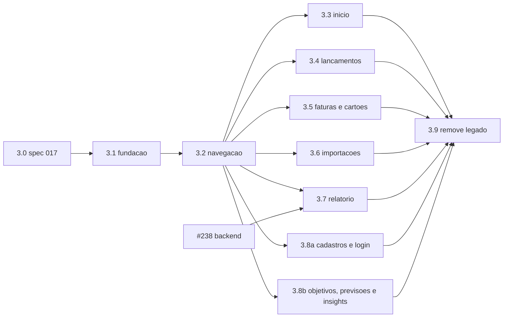

# Spec 017 - Remodelacao da Interface

Herda a baseline da spec 000, os padroes de uso da spec 002 (filtros, status, estados vazios, confirmacoes), a ADR-007 (direcao visual), a ADR-012 (GET nunca grava), a ADR-014 (tabela vira lista empilhada no celular) e a ADR-018 (CSS em camadas com dono por arquivo, tema no navegador e migracao com convivencia; registra D1, D2 e D5 abaixo). Entrega da Etapa 3 do plano-mestre (Confluence, espaco FIN, pagina 950274). Epico Jira FIN-34, versao "E3 Remodelacao da interface".

Fontes visuais: `docs/design/DESIGN.md` (tokens, tipografia, componentes, layout), `docs/design/README.md` (decisoes de 14/11), `docs/design/wireframes/` e o Figma [controle-financeiro · Remodelacao (FIN-34)](https://www.figma.com/design/ZXFAOIcnPMhKz8AwLhY7Oe).

Absorve #240 (tabelas no celular), #241 (revisao de importacoes no celular) e #242 (filtros recolhiveis).

## Contexto

A interface atual vive num unico `static/css/app.css` (1445 linhas, 46 literais de cor, 20 deles fora do `:root`), fonte do sistema, sidebar azul-marinho e menu `
` no celular. O design novo esta pronto (DESIGN.md, 12 telas no Figma, wireframes das 4 restantes). Falta levar isso ao codigo sem SPA, com templates Django, e de um jeito que as telas sejam remodeladas em paralelo por sessoes diferentes sem conflito de merge.

## Objetivo

- Aplicar os tokens, a tipografia Inter e os dois temas (claro Wise, escuro Mercury) em todas as telas.
- Tema segue o sistema e tem troca manual (Claro, Escuro, Sistema), sem flash do tema errado.
- Navegacao nova: sidebar agrupada no desktop; barra inferior e folha "Mais" no celular.
- Nenhuma pagina mais larga que a tela em 375, 900 e 1280px; listas viram lista empilhada abaixo de 768px (ADR-014).
- "Dashboard" passa a se chamar "Relatorio" (a URL `/reports/month/` nao muda).

## Fora de escopo

- SPA, framework de componentes, build de front-end (Sass, PostCSS, bundler).
- Regra financeira nova, selector novo ou migration. Ajuste de contexto de view so quando a tela precisar de um dado ja calculado em outro lugar.
- Persistir a escolha de tema no banco.
- Teste visual no CI.
- Desenhar no Figma as 4 telas que so existem em wireframe.

## Decisoes

### D1. Divisao do CSS

Arquivos novos em `static/css/`, cada um com um dono:

| Arquivo | Conteudo | Dono |
| ------- | -------- | ---- |
| `tokens.css` | Variaveis de cor por tema, tipografia, raios, espaco, cores do grafico | 3.1 |
| `base.css` | `@font-face` da Inter, reset, elementos (`body`, `h1`-`h3`, `a`, `input`, `select`, `button`), foco, `skip-link` | 3.1 |
| `components.css` | Componentes do DESIGN.md e padroes compartilhados (lista abaixo) | 3.1 |
| `layout.css` | Casca do app: sidebar, topo do celular, barra inferior, folha "Mais", area de conteudo | 3.2 |
| `pages/<app>.css` | Ajustes so daquela tela/app (`home.css`, `transactions.css`, `cards.css`, `imports.css`, `reports.css`, `accounts.css`, ...) | issue dona do app |
| `app.css` | Legado, congelado depois da 3.1 | 3.1 (aliases), 3.9 (remove) |

- `base.html` carrega, nesta ordem: `tokens.css`, `base.css`, `app.css` (ate a 3.9), `components.css`, `layout.css`, e o bloco ``. Cada template de tela inclui o seu `pages/<app>.css` nesse bloco. Sem `@import` (carregamento em paralelo; o `CompressedManifestStaticFilesStorage` de producao versiona cada arquivo).
- Componentes novos usam nomes de classe que nao existem no `app.css`, para o legado nao vazar estilo neles: `.btn` (`--primary`, `--secondary`, `--tertiary`), `.status` (`--positive`, `--warning`, `--neutral`, `--negative`), `.card`, `.balance-card`, `.field`, `.alert`, `.segmented`, `.period-picker`, `.filters` (recolhivel, #242), `.list-table` (tabela no desktop, lista empilhada no celular), `.summary-rows` (rotulo e valor do relatorio), `.progress`, `.empty`.
- Uma issue de tela so edita: os templates do seu app, o seu `pages/<app>.css`, os testes do seu app e, se precisar de JS proprio, `static/js/pages/<app>.js`. Nao edita `tokens.css`, `base.css`, `components.css`, `layout.css`, `app.css`, `app.js`, `base.html` nem partials compartilhados. Se faltar um componente, a sessao registra no PR e resolve com classe em `pages/<app>.css`; a 3.9 promove o que se repetir.
- JS: `app.js` (comportamento de formulario) continua como esta e fica congelado depois da 3.1; JS de tela vai em `static/js/pages/<app>.js`.

### D2. Troca de tema

- Tres estados: Claro, Escuro, Sistema (padrao). A escolha fica no `localStorage` (chave `theme`, valores `light` ou `dark`; ausente = Sistema). Nada vai ao servidor: nenhuma requisicao, nenhum cookie, nenhuma gravacao (ADR-012).
- Sem flash: um script inline e sincrono no `<head>`, antes das folhas de estilo, le a chave (com `try/catch`) e define `data-theme` no `<html>`.
- CSS: `:root` tem o tema claro; `@media (prefers-color-scheme: dark) { :root:not([data-theme="light"]) { ... } }` e `:root[data-theme="dark"]` tem o escuro. Sem JS, o tema segue o sistema.
- `static/js/theme.js` expoe a troca, atualiza `data-theme`, o `<meta name="theme-color">` e dispara o evento `themechange` no `document` (tambem quando o sistema muda e a escolha e Sistema).
- O controle (grupo de 3 opcoes) fica na folha "Mais" no celular e no rodape da sidebar no desktop (3.2). Ele so aparece com JS ativo.

### D3. Chart.js

- As cores do grafico vem dos tokens: `--chart-income`, `--chart-expense`, `--chart-balance`, `--chart-grid`, `--chart-text`, definidos nos dois temas em `tokens.css`. `dashboard.js` le com `getComputedStyle` ao criar o grafico e, no `themechange`, reaplica as cores e chama `chart.update()`. Nenhuma cor fixa em JS.
- A 3.1 faz essa troca no grafico atual; a 3.7 pode mudar o tipo de grafico (o wireframe mostra barras de 6 meses) mantendo a leitura dos tokens.

### D4. Criterio de aceite visual

- `scripts/visual_check.py` (Playwright para Python, em `requirements-dev.txt`, fora da imagem Docker e do CI): entra com usuario e senha de variaveis de ambiente, abre uma lista de URLs em 375, 900 e 1280px nos temas claro e escuro, falha se `document.documentElement.scrollWidth > window.innerWidth` e salva as capturas em `.visual-check/` (ignorado pelo git). Roda contra o servidor local com `seed_demo_data`.
- Cada issue de tela roda o script nas suas URLs e cola no PR a tabela de resultado (URL x largura x tema) e a comparacao com a tela de referencia.
- Referencia por tela: o PNG exportado do Figma em `docs/design/figma/` (claro e escuro), um arquivo por tela e tema (`<tela>-claro.png`, `<tela>-escuro.png`). O MCP do Figma no plano Starter tem limite de chamadas, entao as sessoes nao leem o Figma: o usuario exporta os PNGs uma vez, e eles precisam existir antes da 3.3. As 4 telas so em wireframe (detalhe do lancamento, importar extrato, lista de faturas, folha "Mais") sao implementadas a partir do wireframe e dos componentes do DESIGN.md; nao entram novos componentes nem tokens, e a captura aprovada no PR passa a ser a referencia.
- A 3.9 roda o script em todas as URLs do app.

### D5. Migracao

- O CSS antigo convive ate a 3.9. A 3.1 troca as variaveis do `app.css` por aliases dos tokens novos (`--bg: var(--color-bg-canvas)`, ...) e os literais de cor fora do `:root` por variaveis. Assim toda tela ainda nao remodelada ja fica com a paleta, a Inter e os dois temas, sem quebrar.
- Depois da 3.1 ninguem edita `app.css`. Cada issue de tela troca as classes antigas pelas novas nos seus templates; a 3.9 apaga `app.css`, tira o link de `base.html` e confere que nenhum template usa classe que so existia nele.

### D6. Outras decisoes

| Tema | Decisao |
| ---- | ------- |
| Inter | Arquivos `woff2` (variavel, subconjunto latino) em `static/vendor/inter/` com a licenca OFL, como o Chart.js. Sem Google Fonts: o app roda local e nao chama terceiros. |
| Status | Quatro variantes do DESIGN.md. `STATUS_BADGE_VARIANTS` mapeia `success` -> Positivo, `warning` -> Atencao, `danger` -> Negativo, `info` e `neutral` -> Neutro (previsto, aberto e em dia deixam de ser azul). `status_badge_class` devolve as classes novas; a spec 002 e atualizada na 3.1. |
| Lista empilhada (ADR-014) | Uma marcacao so: `<table class="list-table">`. Abaixo de 768px, cada `<tr>` vira grade com descricao e valor na primeira linha e metadados na segunda; colunas de acao somem da linha (vao para o detalhe ou botoes na linha); a descricao e um link que cobre a linha toda. Sem tabela duplicada. |
| Filtros (#242) | `.filters` e o partial `filter_bar` viram `
` abaixo de 768px com resumo "Filtros (N ativos)"; periodo (mes e ano) fica fora, numa linha compacta. Acima de 768px, abertos. Sem JS. |
| Breakpoint | 768px, como na spec 002 e no DESIGN.md. |
| Relatorio | Rotulo "Relatorio" na navegacao e no titulo; namespace e URL `reports` nao mudam. |
| Testes de template | Asserts que procuram classe ou cabecalho antigo mudam na issue que troca o template; asserts de dado e de link nao mudam. |

## Requisitos (EARS)

### Fundacao (3.1)

- R-01: O sistema SHALL definir em `tokens.css` todas as cores do DESIGN.md para os temas claro e escuro, com os nomes `--color-*` derivados do token.
- R-02: QUANDO nao houver escolha salva, ENTAO o tema SHALL seguir `prefers-color-scheme`.
- R-03: QUANDO houver `theme=dark` ou `theme=light` no `localStorage`, ENTAO o `<html>` SHALL receber `data-theme` antes da primeira pintura.
- R-04: QUANDO o usuario trocar o tema, ENTAO o app SHALL NOT fazer requisicao ao servidor nem gravar cookie.
- R-05: O texto do app SHALL usar Inter servida de `static/vendor/inter/`.
- R-06: QUANDO o tema mudar com o relatorio aberto, ENTAO o grafico SHALL redesenhar com as cores do tema novo, sem recarregar a pagina.
- R-07: `status_badge_class` SHALL devolver uma das quatro variantes do DESIGN.md para todo status.
- R-08: Telas ainda nao remodeladas SHALL exibir a paleta e a fonte do tema ativo, sem cor fixa do tema antigo.

### Navegacao (3.2)

- R-09: EM telas de 768px ou mais, o app SHALL exibir a sidebar de 240px com os grupos Principal, Dinheiro e Dados e o item ativo em `brand-pale`.
- R-10: EM telas abaixo de 768px, o app SHALL exibir a barra inferior fixa com Inicio, Lancamentos, novo lancamento, Faturas e Mais.
- R-11: QUANDO o usuario tocar em Mais, ENTAO a folha SHALL listar as demais telas e o controle de tema, e SHALL fechar com toque fora, Esc ou novo toque em Mais.
- R-12: O conteudo SHALL NOT ficar escondido atras da barra inferior.

### Telas (3.3 a 3.8b)

- R-13: EM 375, 900 e 1280px, nos dois temas, nenhuma pagina SHALL ter `scrollWidth` maior que a largura da janela.
- R-14: EM telas abaixo de 768px, toda lista de registros e tabela-resumo listada na ADR-014 SHALL usar lista empilhada ou linhas rotulo e valor, com o valor visivel sem rolagem lateral.
- R-15: EM telas abaixo de 768px, os filtros de lancamentos e da revisao de importacoes SHALL ficar recolhidos, com a contagem de filtros ativos no resumo.
- R-16: EM telas abaixo de 768px, a barra de acoes em lote da revisao de importacoes SHALL ocupar uma linha e SHALL NOT sobrepor o topo (#241).
- R-17: Os filtros de data da revisao de importacoes SHALL usar `BRDateInput` (#241).
- R-18: QUANDO um valor de despesa for exibido no tema claro, ENTAO ele SHALL estar dentro de uma superficie `surface` (contraste AA).
- R-19: A remodelacao SHALL NOT mudar dados exibidos, rotas, metodos HTTP nem regras de negocio.

### Encerramento (3.9)

- R-20: QUANDO a 3.9 terminar, ENTAO `static/css/app.css` SHALL NOT existir e nenhum template SHALL usar classe definida so nele.
- R-21: `scripts/visual_check.py` SHALL passar em todas as URLs do app nas 6 combinacoes de largura e tema.

## Testes

- Template: script de tema no `<head>` antes do primeiro `<link rel="stylesheet">`; ordem dos CSS; `data-theme` ausente no HTML do servidor.
- Unidade: `status_badge_class` para cada status de `STATUS_BADGE_VARIANTS` (variantes novas).
- Navegacao: item ativo por namespace; itens da barra inferior e da folha "Mais"; rotulo "Relatorio".
- Telas: smoke das views de cada app com a marcacao nova (`list-table`, `filters`, `status`).
- Visual: `scripts/visual_check.py` por issue e completo na 3.9 (manual, fora do CI).
- Gate de toda issue: `python manage.py check`, `python manage.py makemigrations --check --dry-run`, `python manage.py test`.

## Quebra em issues

Branches no padrao de `.github/BRANCHING.md` (`<prefixo>/<numero>-<descricao>`). Espelhos no Jira: epico FIN-34, versao "E3 Remodelacao da interface".

| Item | Issue (Jira) | Titulo | Depende de | Arquivos (dono) | Paralelo com | Branch |
| ---- | ------------ | ------ | ---------- | --------------- | ------------ | ------ |
| 3.1 | #290 (FIN-48) | `feat(ui): fundacao visual com tokens, Inter e temas claro e escuro` | spec 017 | `static/css/tokens.css`, `base.css`, `components.css`, `app.css` (aliases); `static/js/theme.js`, `dashboard.js`; `static/vendor/inter/`; `templates/base.html` (head); partials `status_badge`, `empty_state`, `filter_bar`, `messages`; `core/templatetags/money.py`; `scripts/visual_check.py`, `requirements-dev.txt`, `.gitignore`; `docs/design/tokens.md` (aponta para DESIGN.md), remove `ui-preview-home.html`; specs 000 e 002 | nada | `feat/290-fundacao-visual` |
| 3.2 | #291 (FIN-49) | `feat(ui): navegacao com sidebar, barra inferior e folha Mais` | 3.1 | `static/css/layout.css`; `templates/base.html` (body); partials `sidebar`, `nav_links`, novos `bottom_nav`, `more_sheet`, `theme_switch`; testes de `core` da navegacao | nada | `feat/291-navegacao` |
| 3.3 | #292 (FIN-50) | `feat(home): inicio no visual novo` | 3.2 | `core/templates/core/home.html`, `summary_detail.html`; `static/css/pages/home.css`; `core/tests/` da home | 3.4, 3.5, 3.6, 3.7, 3.8a, 3.8b | `feat/292-inicio-visual-novo` |
| 3.4 | #293 (FIN-51) | `feat(transactions): lancamentos no visual novo com lista empilhada e filtros recolhiveis` | 3.2 | `transactions/templates/transactions/*`; partial `transaction_table`; `static/css/pages/transactions.css`; `static/js/pages/transactions.js` (se precisar); `transactions/tests/` | 3.3, 3.5, 3.6, 3.7, 3.8a, 3.8b | `feat/293-lancamentos-visual-novo` |
| 3.5 | #294 (FIN-52) | `feat(cards): faturas e cartoes no visual novo` | 3.2 | `cards/templates/cards/*`; `static/css/pages/cards.css`; `cards/tests/` | 3.3, 3.4, 3.6, 3.7, 3.8a, 3.8b | `feat/294-faturas-cartoes-visual-novo` |
| 3.6 | #295 (FIN-53) | `feat(imports): importacoes no visual novo e revisao no celular` | 3.2 | `imports/templates/imports/*`; `imports/forms.py` (`BRDateInput` nos filtros); `static/css/pages/imports.css`; `imports/tests/` | 3.3, 3.4, 3.5, 3.7, 3.8a, 3.8b | `feat/295-importacoes-visual-novo` |
| 3.7 | #296 (FIN-54) | `feat(reports): relatorio mensal no visual novo` | 3.2, #238 | `reports/templates/reports/*`; `static/js/dashboard.js` (tipo de grafico); `static/css/pages/reports.css`; `reports/tests/` | 3.3, 3.4, 3.5, 3.6, 3.8a, 3.8b | `feat/296-relatorio-visual-novo` |
| 3.8a | #297 (FIN-55) | `feat(ui): cadastros e login no visual novo` | 3.2 | templates de `accounts`, `categories`, `institutions`, `installments`, `templates/registration/login.html`; `static/css/pages/<app>.css` desses apps; testes desses apps | 3.3, 3.4, 3.5, 3.6, 3.7, 3.8b | `feat/297-cadastros-login-visual-novo` |
| 3.8b | #298 (FIN-56) | `feat(ui): objetivos, previsoes e insights no visual novo` | 3.2 | templates de `goals`, `recurrences`, `insights`; `static/css/pages/<app>.css` desses apps; testes desses apps | 3.3, 3.4, 3.5, 3.6, 3.7, 3.8a | `feat/298-objetivos-previsoes-insights-visual-novo` |
| 3.9 | #299 (FIN-57) | `refactor(ui): remove o CSS legado e roda a checagem visual final` | 3.3 a 3.7, 3.8a, 3.8b | apaga `static/css/app.css`; `templates/base.html` (link); classes legadas restantes em qualquer template; promove repeticoes para `components.css`; specs 000 e 002 | nada | `refactor/299-remove-css-legado` |

Fechamento das issues antigas: #241 fecha na 3.6. #240 e #242 cobrem telas de varias issues (lancamentos, contas, cartoes, categorias...): 3.4, 3.5, 3.6, 3.8a e 3.8b citam `Refs`, e a 3.9 fecha as duas depois da checagem visual completa.

## Assumptions

- `seed_demo_data` gera dados suficientes para todas as telas na checagem visual.
- O Playwright roda na maquina do usuario (fora do Docker), com o servidor local em `runserver`.
- O app nao tem Content-Security-Policy; se ganhar uma, o script inline do tema precisa de hash.
- Os PNGs do Figma em `docs/design/figma/` existem antes da onda de telas (3.3 a 3.8b); o usuario os exporta e adiciona fora deste PR.

## SDD Baseline

Esta spec herda comandos, estrutura, estilo, estrategia de testes e boundaries de `docs/specs/000-sdd-baseline.md`.
